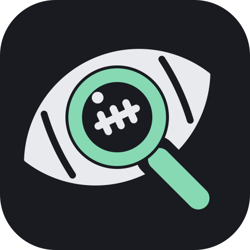

<p align="center">
  
</p>

<h1 align="center">League Lens</h1>

<p align="center">
  A self-hosted fantasy football dashboard for your ESPN and Sleeper leagues.
</p>

<p align="center">
  <a href="LICENSE"></a>
  
</p>

League Lens pulls every team you manage, across ESPN and Sleeper, into one
dashboard that runs on your own computer. It shows what needs your attention
this week: matchups, lineup problems, injuries, byes, and player news. No
account, subscription, or paid data feed is required.

> [!WARNING]
> League Lens is in early development. It has no login yet and is meant to run
> only on your own machine (`localhost`). Do not expose it to the internet.

## Table of contents

- [Features](#features)
- [Roadmap](#roadmap)
- [Installation](#installation)
- [Connecting leagues](#connecting-leagues)
- [Updating, stopping, and removing](#updating-stopping-and-removing)
- [Configuration](#configuration)
- [Privacy and security](#privacy-and-security)
- [Development](#development)
- [Contributing](#contributing)
- [License](#license)

## Features

**Leagues**

- ESPN (including private leagues) and Sleeper in one place.
- Imports full leagues: every team, roster, record, and the current season's
  weekly history.
- Players are matched exactly across providers using public ID mappings.
  Players are never merged by name alone.

**Overview**

- **Attention:** alerts for empty starting slots, injured starters (Out,
  Doubtful, and IR need action; Questionable is flagged to monitor), and
  starters on bye. Alerts disappear at kickoff and can be dismissed with Undo.
- **Matchups:** this week's score for each of your teams, with when each score
  was fetched.
- **Player updates:** recent player news (RotoWire blurbs from ESPN) for your
  rostered players, with injuries first. You can filter by league, player, or
  injuries.

**Matchups page**

- Starting lineups for both teams with each player's points and projection,
  scored with your league's rules, plus a projected total.
- Pick any league and week.

**Player cards**

- Hover or tap a player to see a card with team colors, bio, draft details,
  season stats with position rank, next game, roster percentage, and the latest
  fantasy outlook.

**Sync**

- Saved data shows immediately. Data older than 15 minutes refreshes in the
  background when you open the dashboard. **Refresh** syncs every league now.
- A league that fails to sync keeps showing its last saved data.

**App**

- Light, Dark, and System themes, and a sidebar that collapses on small screens.
- One command to install with Docker. Data is stored in Postgres on your
  machine.

## Roadmap

These features are planned but not built yet. The full checkpoint tracker is in
[docs/roadmap.md](docs/roadmap.md).

- [ ] **Roster and Standings pages.**
- [ ] **Connection health:** show when a league's data is stale or its
  credentials need attention.
- [ ] **Scheduled sync:** keep data fresh without the browser open, using
  persistent background jobs with retries and rate limits.
- [ ] **More alerts:** checks for next week's lineup, and bench players
  projected to outscore starters.
- [ ] **Login and owner setup:** authentication and server-side sessions, so
  the app can be used safely off your own machine.
- [ ] **Backup and restore:** documented and tested.
- [ ] **Optional AI:** bring your own API key for sourced briefings and
  questions about your roster. The dashboard will always work without AI.
- [ ] **Releases:** prebuilt images and release automation.

Not planned yet: Yahoo, win-probability charts, future matchup schedules, and a
standalone CLI.

## Installation

You'll install one free app (Docker), then copy a few commands into a terminal.
No programming is needed.

### 1. Install and open Docker

- **macOS:** install [Docker Desktop](https://www.docker.com/products/docker-desktop/)
  or [OrbStack](https://orbstack.dev/).
- **Windows:** install [Docker Desktop](https://www.docker.com/products/docker-desktop/).
- **Linux:** install Docker Engine with the Compose plugin.

**Open Docker Desktop (or OrbStack) and leave it running.** League Lens runs
inside it, so it must be open whenever you use the app.

### 2. Open a terminal

- **macOS:** press ⌘Space, type `Terminal`, and press Return.
- **Linux:** open the Terminal app from your apps menu.
- **Windows:** open the Start menu, type `PowerShell`, and press Enter.

Paste each command below into the terminal and press Enter (Return on macOS).

### 3. Install just (Mac and Linux)

- **macOS with Homebrew:** paste `brew install just`.
- **Linux:** install `just` with your package manager, or use its official
  installer below.
- **macOS without Homebrew, or Linux using the official installer:** this
  installs `just` in `/usr/local/bin`, a standard place for commands:

  ```sh
  curl --proto '=https' --tlsv1.2 -sSf https://just.systems/install.sh | sudo bash -s -- --to /usr/local/bin
  ```

  Your computer may ask for your password to install it. To check that it
  worked, run `just --version`; it prints a version number.

Windows does not use these `just` commands yet. Continue to
[Windows, or without just](#windows-or-without-just) below instead.

### 4. Download League Lens

```sh
git clone https://github.com/adityachoudhari26/league-lens.git
cd league-lens
```

On macOS, if a window asks to install developer tools, click **Install**, wait
for it to finish, and run the commands again. No Git? Download the ZIP from the
green **Code** button on GitHub, unzip it, and open a terminal in the unzipped
folder.

### 5. Install and open League Lens (Mac and Linux)

```sh
just install
```

This builds League Lens on your computer. The first run takes a few minutes;
then it opens the app in your browser. It is safe to run `just install` again.
The app keeps running in the background after you close the terminal, and starts
again when Docker is open.

#### Windows, or without just

From the `league-lens` folder, run:

```sh
docker compose up -d
```

The first run builds the app and takes a few minutes. When it finishes, open
**http://league-lens.localhost** in Chrome, Edge, or Firefox. In Safari, use
**http://localhost**. Then [connect your leagues](#connecting-leagues).

### If something goes wrong

- **Docker isn't installed or running:** open Docker Desktop (or OrbStack), wait
  until it says it's running, and run the command again.
- **Port 80 is busy:** `just install` automatically tries port 8080 instead.
  When using the Windows instructions above (or running Docker commands
  yourself), create a file named `.env` in the `league-lens` folder with this
  line:

  ```sh
  LEAGUE_LENS_PORT=8080
  ```

  Then run `docker compose up -d` again and open
  `http://league-lens.localhost:8080` (Safari: `http://localhost:8080`).

## Everyday commands

Run these in a terminal from the `league-lens` folder. These `just` commands
work on macOS and Linux.

| Task | Command | What it does |
| --- | --- | --- |
| Install | `just install` | Build, start, and open League Lens. Safe to repeat. |
| Start | `just start` | Start League Lens. |
| Stop | `just stop` | Stop it without deleting your leagues or data. |
| Restart | `just restart` | Restart League Lens. |
| Open | `just open` | Open League Lens in your browser. |
| Status | `just status` | See whether it is running and which version is installed. |
| Logs | `just logs` | Follow recent app activity to help diagnose a problem. |
| Update | `just update` | Download the latest version and restart if it was running. |
| Database shell | `just db-shell` | Open the database prompt; add `-c 'select 1'` to run a query. |

### Updating

On macOS or Linux, run:

```sh
just update
```

On Windows, or if you are not using `just`, update from the `league-lens`
folder with:

```sh
git pull
docker compose up -d --build
```

### Removing League Lens

To delete League Lens and **all saved data**, run `docker compose down -v` from
the `league-lens` folder.

## Connecting leagues

Open the app and click **Connect leagues** on Home (or in **Settings →
Leagues**), then choose ESPN or Sleeper.

### Sleeper

Enter your Sleeper username, then pick the leagues to import. No password is
needed.

### ESPN

ESPN has no sign-in for other apps, so League Lens reads your ESPN sign-in
cookies (`espn_s2` and `SWID`). They're stored encrypted on your computer and
never shown again. There are two ways to connect.

**Option 1: Use a bookmark (recommended)**

1. Show your browser's bookmarks bar: ⌘⇧B on macOS, Ctrl+Shift+B on Windows
   and Linux.
2. In the ESPN step of the dialog, drag the **Connect to League Lens** button
   onto the bookmarks bar. Clicking it inside League Lens, or pasting its code
   into the address bar, does nothing.
3. Open [espn.com/fantasy](https://www.espn.com/fantasy/) and sign in.
4. Click the **Connect to League Lens** bookmark. League Lens opens in a new
   tab with your leagues listed. Pick the ones to import.

Can't drag it? Click **Copy bookmark code**, add a new bookmark by hand, and
paste the code as its URL.

Keep the bookmark. If ESPN later rejects your cookies, Home shows a
**Reconnect** button; click it, then click the bookmark on ESPN again.

**Option 2: Paste your cookies**

1. On espn.com, while signed in, open developer tools: ⌥⌘I on macOS, F12 on
   Windows and Linux.
2. Go to **Application → Cookies → https://www.espn.com** (Firefox: **Storage →
   Cookies**).
3. Copy the **Value** of `espn_s2` and `SWID` into the two fields in the
   dialog.

Removing a league in **Settings → Leagues** hides it and keeps its saved
history.

### Import from the terminal (optional)

The **Connect leagues** dialog is the easiest way. You can also import from
the terminal:

#### Sleeper

Sleeper needs no credentials. Use your Sleeper username and the league ID from
the league URL (`sleeper.com/leagues/<league-id>`):

```sh
docker compose exec app import sleeper --username YOUR_USERNAME --league-id YOUR_LEAGUE_ID
```

#### ESPN

ESPN private leagues need two cookies from a browser where you're signed in to
ESPN:

1. Open [espn.com](https://www.espn.com) and sign in.
2. Open your browser's developer tools, go to **Application** (Chrome/Edge) or
   **Storage** (Firefox), then **Cookies**, and copy the values of `espn_s2`
   and `SWID`.
3. Add them to the `.env` file next to `compose.yaml`:

   ```sh
   ESPN_S2=your-espn_s2-value
   ESPN_SWID={your-swid-value}
   ```

4. Restart the app so it picks up the cookies, then import your league. The
   league ID and team ID come from your team page URL
   (`fantasy.espn.com/football/team?leagueId=<league-id>&teamId=<team-id>`):

   ```sh
   docker compose up -d
   docker compose exec app import espn --league-id YOUR_LEAGUE_ID --season 2026 --team-id YOUR_TEAM_ID
   ```

The season is required because ESPN reuses league IDs across years.

## Configuration

Set these in a `.env` file next to `compose.yaml`. All are optional.

| Variable | Default | Purpose |
| --- | --- | --- |
| `LEAGUE_LENS_PORT` | `80` | Port the app listens on, on `127.0.0.1`. |
| `ESPN_S2`, `ESPN_SWID` | empty | ESPN cookies used for importing and syncing ESPN leagues. |
| `LIVE_SCORES` | `true` | Update live matchup scores every minute; set to exactly `false` to disable. |
| `LOCAL_OWNER_EMAIL` | `owner@localhost` | Label for the local owner. This is not a login. |
| `POSTGRES_PASSWORD` | `league_lens_local` | Password for the bundled Postgres database. |

## Privacy and security

- Everything runs on your machine. The app and database listen only on
  `127.0.0.1`, and the server rejects requests that aren't addressed to
  `localhost`.
- League Lens only reads from ESPN and Sleeper. It never changes your lineups
  or league settings.
- ESPN cookies saved by the app are encrypted (AES-256-GCM) and are never shown
  or logged. If the key is lost, you only need to reconnect ESPN.
- There is no authentication yet. Don't expose the app beyond `localhost`
  until [login and owner setup](#roadmap) ship.
- ESPN's fantasy API is undocumented and may change without notice. Sleeper is
  used through its [public API](https://docs.sleeper.com/).

## Development

League Lens is a Go backend (Connect RPC, PostgreSQL, sqlc, Goose) with a React
and TypeScript frontend (Vite, TanStack Router and Query, Tailwind CSS,
shadcn/ui). In the Docker image, Go serves the built frontend.

To run from source you need Go 1.26+, Node 22.12+ with pnpm, Docker, and
[just](https://just.systems/):

```sh
just setup       # create .env.development
just tools       # install Air for live reload
just setup-web   # install frontend dependencies
just db-up       # start Postgres
just migrate     # apply migrations
just dev         # API and frontend with live reload
```

Open **http://127.0.0.1:5173**. Run `just` to list every command. See the
[development guide](docs/development.md) for testing, code generation, imports,
and the API. Design docs are in [docs/designs](docs/designs).

## Contributing

Contributions are welcome. Please read [CONTRIBUTING.md](CONTRIBUTING.md) first.
It covers Conventional Commit messages, the local Git hooks, and the checks to
run before opening a pull request.

## License

League Lens is released under the [MIT License](LICENSE). ESPN, Sleeper, and
other data sources are subject to their own terms of service.

## Acknowledgments

- [DynastyProcess](https://github.com/dynastyprocess/data) for player ID
  mappings.
- [cwendt94/espn-api](https://github.com/cwendt94/espn-api) for documenting
  ESPN's fantasy API.
- [RotoWire](https://www.rotowire.com/) for player news, delivered through
  ESPN.
